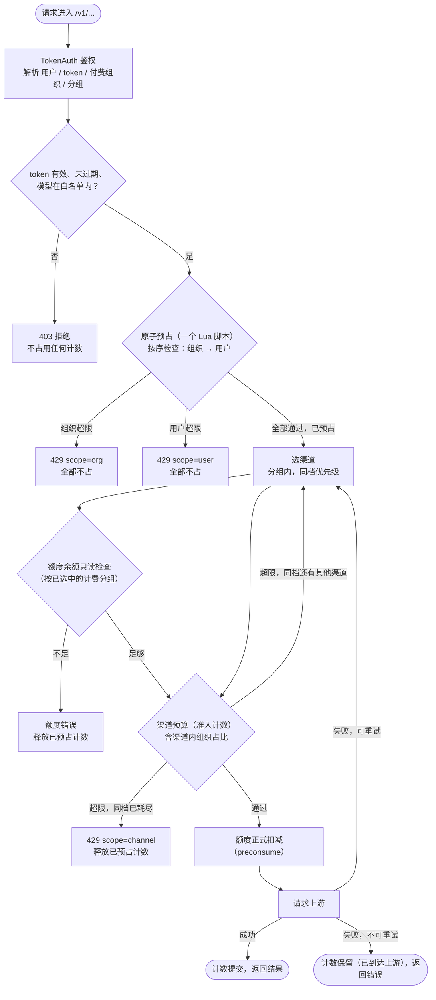

# 多层限速模型设计

## 废弃原因

2026-11-23 决定停止本方案，把请求数限速还原到 v1.0.28 基线（分支 `revert/request-limit-to-v1.0.28`）。线上版本只有用户与分组两层限速，本方案新增的组织上限、渠道预算、渠道占比、用户覆盖和只读总览超出了实际需求，且复杂度过高。本方案不再执行，相关实现已还原，文档仅作历史记录保留。

## 目标

1. 为组织、用户、渠道三类主体建立统一的限速模型，明确每层保护什么、按谁计数、何时计数、拒绝时如何归因。分组不作为限速层（见 D5）。
2. 解决多层叠加时的原子性问题：任一层拒绝，已占用的计数全部释放，不产生白扣。
3. 渠道是唯一对应上游真实配额的层，始终最后检查；超额用户必须在渠道之前被拦下，不能消耗共享渠道的容量。
4. 统一计数口径为准入计，消除现有用户层的成功计和 ±1 偏差。

## 范围

- 只限请求数（RPM 类）。TPM 不在范围内，已确认暂不做。
- 只约定额度检查与限速的先后顺序，不改变额度计费的计算规则。
- 渠道级限速的已实现部分见 `doc/todo/in-progress/channel-rate-limit.md`，本文档在其基础上统一为多层模型。

## 现状（2026-11-20）

- **用户层**：`ModelRequestRateLimit`（`middleware/model-rate-limit.go`）按用户计数，分组覆盖的 key 为 `用户ID:分组`。按**成功**请求计数，请求结束后才记录，检查与记录不是原子的。
- **分组**：不作为限速层（见 D5）。现有的分组覆盖实际是"用户 × 分组"的额度，生产中未配置。
- **组织**：没有限速层。组织只是计费主体（`OrganizationQuotaAccount` / `OrganizationMemberQuota`），付费方由 token 的 `BillingOrganizationId` 决定。
- **渠道**：已实现准入计预算（分支 `feature/channel-rate-limit`），超限时在同优先级内换渠道，耗尽后返回 429。
- **顺序**：鉴权 → 用户层限速 → 选渠道与渠道预算 → 额度预扣 → 上游。

## 已确定的设计决策

### D1 层级与顺序



| 层 | 位置 | 计数主体 | 保护什么 | 拒绝时的 scope |
|---|---|---|---|---|
| 组织 | 预占的第一项 | token 的付费组织（为空则跳过） | 合同额度 | `org` |
| 用户 | 预占的第二项 | 用户，跨分组 | 单用户公平性 | `user` |
| 渠道 | 选渠道之后 | 渠道 | 上游账号配额 | `channel` |
| 渠道内组织占比 | 渠道检查的一部分 | 组织在该渠道上的份额 | 防止组织独占渠道 | `channel_org_share` |

- 组织和用户是**并列约束**，不是父子关系。一个请求同时受两者约束。
- 渠道是唯一对应上游真实配额的层，始终最后检查并兜底。分组不作为限速层（见 D5）。

### D2 计数口径：两个维度（2026-11-20 修订）

- 总请求数（准入计）：请求通过全部预占、到达上游时计数，不论成败。
- 成功请求数（成功计）：请求完成后、且成功时计数。准入时检查"已成功数是否达到上限"，完成后递增。
- 两个维度的语义与现状一致，生产环境的有效上限不变；修订的是实现方式，让两者都参与原子预占。
- 在到达上游之前被拒绝的请求（预占失败、额度不足、渠道耗尽、无可用渠道），释放已占用的全部计数。
- 重试（渠道换路，或上游失败后的重试）不重复预占组织、用户计数。
- 拒绝原因统一使用 `ErrOptionWithSkipRetry`，不消耗 `common.RetryTimes`，不触发渠道自动禁用，不写渠道亲和缓存。

### D3 原子预占

- 组织、用户的计数器在**一个 Lua 脚本**中原子地检查并预占；任一超限则两项都不占，无需回滚。
- 渠道预算在选渠道之后单独检查（已实现的准入计令牌桶）。渠道拒绝时，释放已预占的组织、用户计数。
- 所有参与同一脚本的 key 必须位于同一 Redis 实例上。若将来改用 Redis Cluster，需要使用 hash tag 保证同槽。
- 计数器 key 约定：
  - 组织：`rateLimit:org:<orgID>`
  - 用户：`rateLimit:user:<userID>`（跨分组）
  - 渠道：`rateLimit:channel:<channelID>`（已实现）
  - 渠道内组织占比：`rateLimit:channel:<channelID>:org:<orgID>`

### D4 拒绝归因

- 429 响应带 `Retry-After`（精确值以 TTL 或桶的补充时间计算）。
- 错误体与 policy event 中记录 `rate_limited_scope`，取值为 `org` / `user` / `channel` / `channel_org_share`。
- `x-ratelimit-limit` / `remaining` / `reset` 响应头待定：需要 Lua 返回剩余量，见待核实事项 8。

### D5 不设分组限速层（2026-11-20 决定）

- 分组不作为限速层。组织、用户、渠道三层已覆盖需要的保护；分组层的两个用途各有替代方案。
- **分组总量封顶**：付费组织的流量由组织总量封顶；个人 token 的流量由该分组专属渠道的渠道预算封顶。线上渠道都只属于一个分组，渠道预算即等同于该分组的总量上限。
- **共享渠道上的跨分组隔离**：线上不存在共享渠道。启用中的 12 个渠道均只属于一个分组（2026-11-20 生产只读查询）。若将来出现多分组共享的渠道，通过渠道层扩展处理，不新增分组层。
- **用户 × 分组覆盖**（`ModelRequestRateLimitGroup`）一并取消：它按分组区分，与本决定矛盾。生产中该配置为空，取消不改变现有行为。代码删除另行安排。
- **边界**：组织总量只计付费组织的请求。渠道预算限的是该渠道的总量；若渠道被多个分组共享，"渠道即分组总量"的结论不再成立，届时需要重新评估。

### D6 组织：只做组织总量

- 只对 `BillingOrganizationId` 非空的请求计数。个人 token 的请求即使属于组织成员，也不计入组织。
- 第一版只做组织总量上限，不做组织内成员分配。
- 组织上限存放在关系表中（D11）。组织总量**只由 root 设置**，组织管理员只能查看。

### D7 渠道内组织占比（已同意）

- 每个组织在某个渠道上有一个**静态占比上限**（例如 50%–70%），换算为该组织在该渠道上可用的令牌数。
- 未配置时不限制，行为与现状一致。
- 第一版只做静态上限。"有竞争时才生效、可借用空闲容量"的机制列为后续优化，不在第一版内。
- 与用户层互补：组织占比防止**跨组织**独占渠道；用户层防止**组织内**单个用户独占。

### D8 额度检查顺序（2026-11-20 修订）

- 2026-11-20 决定：不实施额度只读检查。第 1 步量化显示额度预扣拒绝只占 1.57%，且全部来自组织成员额度，被拒请求的渠道预算与准入已由释放路径退还。只保留释放路径，详见 [额度只读检查前移（已关闭）](../done/quota-readonly-check.md)。下面的原方案不再实施。

- 额度**只读检查**放在"选渠道之后、占用渠道预算之前"。选渠道后才能确定计费分组（`auto` 分组下由选中的渠道决定），检查用的价格才与实际计费一致。
- 额度**正式扣减**放在渠道通过之后、请求上游之前。
- 这样渠道令牌不会被额度不足的请求白占。
- 实现上需要把"选择渠道"和"占用渠道预算"拆开。
- 涉及计费文件的实施，必须先完整阅读 `.agents/rules/billing.md`。

- 额度**只读检查**放在选渠道之前；额度**正式扣减**放在渠道通过之后、请求上游之前。
- 这样渠道令牌不会被额度不足的请求白占。
- 只读检查所依赖的价格维度必须先核实，见待核实事项 1。
- 涉及计费文件的实施，必须先完整阅读 `.agents/rules/billing.md`。

### D9 白名单前移

- token 有效性、过期时间、模型白名单检查前移到预占之前。被这些检查拒绝的请求不占用任何计数。
- 当前代码中模型白名单检查在 `Distribute` 中，位于用户层限速之后，实施时需要调整。

### D10 前端入口：编辑归位，只读总览

- **每个配置只在其归属对象的页面编辑**，不在多处重复写入，只有一个真相来源：
  - 渠道预算与渠道内组织占比：渠道编辑抽屉的高级设置。
- **限速总览页（只读）**：按请求顺序列出组织、用户、渠道三层的当前值，并链接到各自的编辑页。输入一个用户、组织或渠道，显示它的生效上限，以及哪一层会先拒绝请求。总览页不写入任何数据。
- **用户覆盖不放在 `User.Setting`**：该字段是用户可写区，用户自己可以修改，限额只能由管理员写。

## 存储设计

### D11 存储：关系表 `rate_limit_overrides`

用户覆盖和组织总量统一存放在一张关系表中，不放在 option 映射或 `User.Setting` 里。

```
rate_limit_overrides
  id             主键
  subject_type   user | organization
  subject_id     用户 ID 或组织 ID
  group_name     分组覆盖时填写，否则为空
  total_count    总请求上限
  success_count  成功请求上限（若沿用准入计，可与总请求上限合并，待 Phase 0 确认）
  updated_by     最后修改人
  updated_time   最后修改时间
  唯一索引 (subject_type, subject_id, group_name)
```

- **稀疏存储**：只存有覆盖的行。表的大小取决于被覆盖的主体数，而不是全部用户数。
- **请求路径不查库**：各节点在内存中缓存覆盖表，按 `SYNC_FREQUENCY` 定期加载，并在修改后刷新。未覆盖的主体使用全局默认值。
- **写入只经过管理员接口**：频率低，单行写入，不会像 option 那样整块读改写互相覆盖。组织总量的写入接口只对 root 开放。
- **为什么不用 option 映射**：option 会整块加载进每个节点的内存，每次修改都要重写整个 JSON，没有行级并发控制，也不便于按主体查询和审计。它只适合数量少、全局、低基数的配置。
- **全局默认仍放在 option**：全局低基数配置。
- **数据库验证**：新表须按 `AGENTS.md` 的数据库规则，在 SQLite、MySQL ≥ 5.7.8、PostgreSQL ≥ 9.6 上验证：全新建库；从最新发布版本升级的迁移；启动迁移至少执行两次，确认幂等。

## 待核实事项

1. **价格维度**：额度只读检查所用的价格是否只取决于模型和分组，不取决于具体渠道？如果取决于渠道，只读检查只能放在选渠道之后，或接受一次估算。
2. **组织占比的配置存放**：`Organization` 没有 `Setting` 字段，新增需要加列并走三库验证。候选方案是把占比写进 `Channel.Setting` 的映射（例如 `org_shares: {"<orgID>": 0.5}`），由管理员维护，不需要迁移。**推荐后者，待确认。**
3. **用户层口径变化**：从成功计改为准入计，失败请求也会计数，正式环境的有效上限会变严格。需要确认是否接受，并决定迁移期的策略（例如先在本地和灰度环境观察）。
4. **Redis 故障策略**：渠道层是 fail-open。用户层现在是 fail-closed（返回 500）。多层统一后，建议：容量保护面（渠道）fail-open；与鉴权相关的组织、用户层保持 fail-closed。**已确认（2026-11-20）。**
5. **原子脚本的性能**：每个请求一次 EVAL，涉及 3 到 5 个 key。需要压测确认延迟和 Redis 负载。
6. **（已取消，见 D5）分组覆盖的迁移语义**：现有配置如 `{"vip": [total, success]}` 的含义是"用户 × 分组"的两个上限。迁移为用户层的分组覆盖后，`total` 与 `success` 分别对应什么口径（准入计后两者是否还有区别）？
7. **数据库变更**：当前设计不需要表结构变更。若组织占比的配置最终需要落表，必须按三库矩阵（SQLite / MySQL ≥ 5.7.8 / PostgreSQL ≥ 9.6）验证。
8. **响应头**：`x-ratelimit-*` 需要 Lua 返回剩余量，待定。
9. **用户覆盖的存储（已按 D11 确定）**：覆盖数量可能很大，缓存的内存占用和刷新耗时需要在 Phase 3b 压测确认（见验收条件 14）。
10. **组织总量的存储（已按 D11 确定）**：组织数量通常远少于用户，与用户覆盖共用同一张表。

## Phase 0 核实结果（2026-11-20）

本节记录待核实事项 1、3、4、6 的核实结果。核实只读代码，没有改动代码。阅读的计费代码遵循 `.agents/rules/billing.md`。

### 事项 1：价格维度（结论：需要修订 D8）

- 基础价格（`relay/helper/price.go` 中的 `ModelPriceHelper`）不读取渠道，只依赖模型和计费分组（`HandleGroupRatio`）。
- 但在 `auto` 分组下，计费分组由选中的渠道决定：`CacheGetRandomSatisfiedChannel` 写入 `auto_group` 上下文，`HandleGroupRatio` 读取它来确定 `UsingGroup` 和分组倍率。阶梯计费还会在选渠道之后通过 `PrepareTieredBillingForSelectedGroup`（`service/tiered_settle.go:206`）刷新。
- 因此，额度只读检查**不能在选渠道之前做**。否则 `auto` 分组下，检查用的价格可能与实际计费分组不一致。
- **建议修订 D8**：额度只读检查放在"选渠道之后、占用渠道预算之前"。这样价格与实际分组一致，也不会浪费渠道令牌。实现上需要把"选择渠道"和"占用渠道预算"拆开；当前的 `SelectChannelWithBudget` 把两者合在一起。
- OpenRouter Claude 的 token 调整（`service/text_quota.go:270`）只发生在结算阶段，不影响预扣估算，不阻碍设计。

### 事项 3：用户层口径（结论：需要修订 D2）

- 现有用户层已经有两个维度：
  - 总请求数（`ModelRequestRateLimitCount`）：在请求前计数，是准入计（Redis 路径为令牌桶，内存路径为滑动窗口）。
  - 成功请求数（`ModelRequestRateLimitSuccessCount`）：请求结束后计数，是成功计。
- 因此不需要把成功计改为准入计。**建议修订 D2**：保留两个维度各自的语义，生产环境的有效上限不变，只改变实现方式，让两个维度都参与原子预占。
- 成功计维度无法在请求前精确预占。可以在准入时检查"已成功数是否达到上限"，请求完成后再递增，这与预占框架兼容。
- Redis 路径与内存路径的差异：内存路径对成功计使用 `Reserve` 统计在途请求，Redis 路径没有。检查与记录不是原子的，这是 ±1 偏差的来源。

### 事项 4：Redis 故障策略（结论：现状不一致，需要确认）

- 用户层（Redis 路径）现在是 fail-closed：检查出错时返回 500（`rate_limit_check_failed`，`middleware/model-rate-limit.go:92,115`）。
- 渠道预算是 fail-open：`AcquireChannelBudget` 出错时放行并记录日志（`service/channel_rate_limit.go`）。
- 两者不一致。建议见待核实事项 4 的正文。

### 事项 6：分组覆盖的语义（结论：保持现有语义；分组层已于 2026-11-20 取消，见 D5）

- `ModelRequestRateLimitGroup` 的 `[total, success]` 对应事项 3 的两个维度：`total` 是用户在该分组的准入计上限，`success` 是成功计上限。
- 迁移为用户层的分组覆盖时保持语义不变，不改变生产环境的行为。分组共享池是新增的维度，与覆盖分开存放。

### 已确认的修订（2026-11-20）

1. **D8**：额度只读检查改为"选渠道之后、占用渠道预算之前"（已确认）。
2. **D2**：保留总请求数（准入计）和成功请求数（成功计）两个维度（已确认）。
3. **事项 4**：容量保护面 fail-open，鉴权相关的组织、用户层 fail-closed（已确认）。

Phase 0 已完成。Phase 1 的实施尚未开始。

## Phase 1 实施状态（2026-11-20）

实施分支：`feature/rate-limit-reservation`（基于 `feature/channel-rate-limit`），提交 `a1cf7f672`，已推送，未合并。

**已完成：**

- 用户层的两个维度（总请求数、成功请求数）在同一个 Lua 脚本中原子预占。任一维度拒绝时，两者都不写入。
- 在途请求计入成功上限，使用有序集合记录。这修复了 ±1 偏差。
- 请求结束后统一结算：成功则记录成功数；到达上游但失败则只保留准入计数；未到达上游即被拒绝则释放全部预占。
- 到达上游的标记设在 distributor 和 Responses WebSocket 的选渠道成功之后。
- 时间由应用节点传入，不依赖 Redis 服务端时间和节点时区。计数 key 使用新前缀 `rateLimit:v3:model:*`。
- `docs/authentication.md` 已同步更新。

**验证结果：**

- `gofmt`、`go vet ./middleware/`、`go build ./...` 通过。
- `go test ./middleware/ ./controller/ ./relay/ ./service/` 通过。
- `./router/` 中的 `TestAccessTokenRouteRulesCoverEveryDashboardRoute` 失败。在基线分支上同样失败，与本次改动无关，属于已有问题。
- 真实 Redis（WSL Redis 7.0.15，DB 15）上的并发测试：300 个并发请求，成功上限 50，准确放行 50 个。连续三轮都通过。
- 本地 E2E（DB 14，默认参数，Phase 1 构建）：
  - 顺序请求：精确 1000 次成功，第 1001 次返回 429。之前的 +1 偏差消失。
  - 并发请求（1400 个，20 路并发）：1000 次成功，400 次 429，上游只收到 1000 次。
  - 渠道拒绝释放：1 个请求成功，其余 4 个被渠道预算拒绝；成功计数只增加 1，在途计数为 0。

**已知缺口（Phase 1 之后处理）：**

- 额度预扣失败发生在选渠道之后，此时请求已标记为到达上游，因此会保留准入计数。在 Phase 5 调整额度检查顺序后解决。
- 总请求数的"释放并退还准入"路径，本地 E2E 无法验证（本地配置中总请求数上限关闭），只有单元测试覆盖。
- Responses WebSocket 路径只做了代码审查，没有端到端测试。
- 组织层不在 Phase 1 范围内，留给 Phase 2。分组共享池已取消（见 D5）。
- `x-ratelimit-*` 响应头仍未实现（Lua 不返回剩余量）。

## 验收条件

1. 任一层拒绝时，其他层的计数全部保持不变（通过测试断言）。
2. 渠道层拒绝时，组织、用户的预占全部释放。
3. 在到达上游之前被拒绝的请求不计数；到达上游后失败的请求计数保留。
4. 重试不重复预占组织、用户计数。
5. 组织占比未配置时，行为与现状一致；配置后，并发下单个组织在该渠道的准入数不超过占比上限。
6. 超额用户的请求在用户层被拒绝时，不消耗渠道预算。对比测试中，渠道容量在超额用户被拒后仍可供其他用户使用。
7. 并发 N 个请求时，用户层成功数恰好等于上限（±1 偏差消除）。
8. 429 的 `rate_limited_scope` 与实际拒绝的层一致。
9. 额度不足的请求不占用渠道预算。
10. 用户覆盖只能由具备用户管理权限的管理员设置；非管理员调用返回 403，且用户自己的 `User.Setting` 无法修改限额。
11. 组织总量只能由 root 设置；组织管理员调用写入接口返回 403，只能读取。
12. 所有改动通过 `go build`、相关包的测试；Redis 路径在真实 Redis 上验证；涉及计费的改动满足 `.agents/rules/billing.md`。
13. 覆盖表在多节点间保持一致：某节点修改覆盖后，其他节点在一个同步周期内生效。
14. 覆盖表规模压测：在目标覆盖行数（待 Phase 3b 确定，例如 10 万行）下，单节点缓存的内存占用和刷新耗时在可接受范围内，结果记录在验证结果中。

## 实施计划

每个阶段独立可验证，按顺序推进。

- **Phase 0：核实待定事项**（不改代码）：待核实事项 1、3、4、6。
- **Phase 1：原子预占框架与准入计**
  - 实现多计数器 Lua 脚本，提供预占、释放、提交接口。
  - 用户层迁移为准入计，消除 ±1 偏差。
  - 渠道层接入同一框架，保持在最后检查，释放逻辑统一。
  - 测试：真实 Redis 下的并发测试，以及释放语义测试。
- **Phase 2：组织层**：组织总量上限，只计 token 付费组织。组织总量存放在 `rate_limit_overrides`（D11）；组织详情页的编辑入口只对 root 显示，组织管理员只读。
- **Phase 3：已取消**：分组限速层不再实施，见 D5。
- **Phase 3b：用户覆盖**：`rate_limit_overrides` 表的迁移与三库验证、缓存与刷新、写入接口（D11），以及用户编辑抽屉中的入口。规模压测（验收条件 14）在此阶段完成。
- **Phase 4：渠道内组织占比**：依赖待定事项 2 的确定。渠道编辑抽屉的高级设置同时承载渠道预算和组织占比。
- **Phase 5：白名单前移与额度只读检查**：涉及计费，先阅读 billing 规则。
- **Phase 6：scope 归因、响应头、限速总览页（只读）**。

## 未覆盖项与风险

- TPM 不做（已确认）。
- 渠道内的"有竞争时才生效"借用机制不做。
- 组织内成员分配不做。
- Responses WebSocket 路径需要在 Phase 1 一并接入预占框架，并补测试。
- 用户层口径变化会影响正式环境已有行为，上线前需要提前通知。

## 验证结果

（实施后填写）

## 阻塞原因

（不适用）
